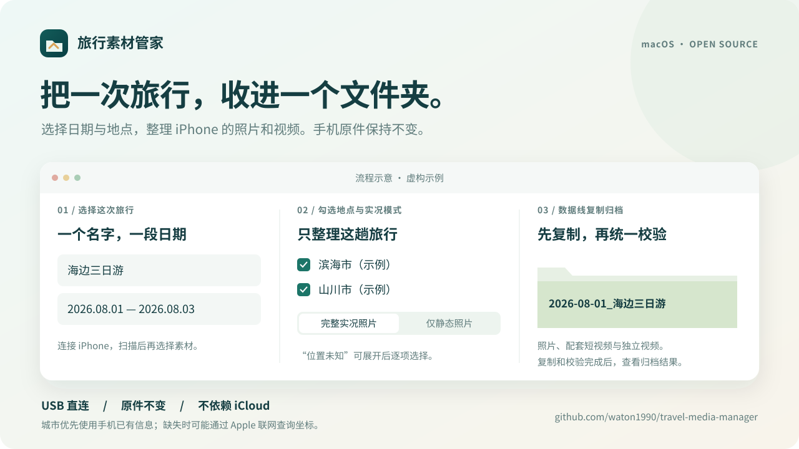

# Travel Media Manager · 旅行素材管家

**Archive one trip into one folder, using dates and places.**

A native macOS app that copies travel photos and videos from an iPhone over USB, or supported media from a camera card/local folder. Originals remain unchanged.

[简体中文](README.md) · [Installation (Chinese)](docs/INSTALL.md) · [User guide (Chinese)](docs/USER_GUIDE.md) · [Privacy](docs/PRIVACY.md) · [Contributing](CONTRIBUTING.md)



*Workflow illustration with fictional data; not a screenshot.*

[Actual app window](assets/app-preview.png), using a fictional trip name without connecting or scanning a device.

## Status and downloads

**0.3.1, build 10 — community preview.** The release app is Developer ID signed and Apple notarized, with a stapled notarization ticket. This update improves distribution and installation; archive behavior is unchanged.

Check [Releases](https://github.com/waton1990/travel-media-manager/releases) for available artifacts and checksums. GitHub’s automatic Source code archives require a local build. An installable app is available only when explicitly attached to a release. See the [installation guide](docs/INSTALL.md) for the test package and macOS first-launch prompts.

The existing app targets **Apple Silicon Macs** and is Developer ID signed and Apple notarized. The package declares macOS 13 as its minimum; earlier macOS versions and Intel Macs have not been runtime-validated. The app UI is currently in Simplified Chinese.

## Features

- **iPhone over USB:** filter locally available photos and videos explicitly classified as “Taken by Me” in the phone’s index, then select dates and cities/regions. Unknown locations are selectable individually.
- **Folders/camera cards:** recursively scan supported photos, videos and audio by capture date; ignore LRF and unsupported auxiliary files.
- **Live Photos:** keep the original still and paired video by default, or import only the still. Standalone videos remain included.
- **Copy, then verify:** the iPhone workflow fixes the selection before copying, copies the batch, then verifies local hashes and complete Live Photo pairs.
- Keep original filenames in one `start-date_trip-name` folder. No source deletion, modification or moving; no overwriting existing results.

## Quick start

Enter a trip name and dates, select the source and destination, scan, choose places and Live Photo mode, then archive. Use the system folder picker rather than typing paths. For iPhone scans/imports, quit iPhone Mirroring, connect by cable, unlock the phone and trust the Mac. Keep it connected until copying and verification finish.

Photos and videos do not travel through iCloud. Existing valid city labels are preferred; missing labels may trigger an Apple reverse-geocoding request that sends coordinates, not media contents. Index snapshots are read to temporary local storage and can contain metadata outside the selected dates. See [privacy details](docs/PRIVACY.md).

## Limitations

Phone classification and resource mapping depend on recognized internal iOS index formats. Unsupported structures stop or limit scanning. Cloud-only originals are not downloaded. iPhone mode excludes independent audio, Voice Memos, hidden/deleted items and editing sidecars. Albums and edit history are not reconstructed.

There is no resume, append-to-existing-trip, automatic deduplication or rename-on-conflict. Complete resource mapping is still required in still-only mode. Known cities are selected as groups; unknown locations use a filename/date/type list without thumbnails.

## Build and test

Use macOS development tools and [uv](https://docs.astral.sh/uv/getting-started/installation/) with Python 3.12.14 support. Swift tests require a toolchain that includes Swift Testing.

```sh
bash scripts/build-app.sh
```

The output is `outputs/旅行素材管家.app`. The build pins Python 3.12.14 and may download locked dependencies; app users do not need a separate Python or uv installation. `swift build --product TravelMediaManager` builds only the Swift executable, without the USB runtime.

Local source builds use ad-hoc signing by default. See [the release workflow](docs/RELEASING.md) for Developer ID signing and notarization.

Build 10 passed 300 local checks, app startup and the signed USB helper offline self-check. No real-device scan or import was repeated for this signing release; prior limited device checks do not establish compatibility across devices, libraries or OS versions.

Synthetic checks do not require a phone:

```sh
bash scripts/test.sh
python3 -m unittest discover -s Tests/USBHelperTests -v
bash scripts/test-app-model.sh
bash scripts/test-place-resolution.sh
```

## Contribute and license

Use Issues for reproducible reports, excluding private media, photo indexes, device identifiers and unsanitized logs. Read [CONTRIBUTING.md](CONTRIBUTING.md) before contributing.

Original project code is licensed under **GPL-3.0-or-later**; see [LICENSE](LICENSE). Third-party dependencies retain their own licenses and notices. See [the roadmap](docs/ROADMAP.md) for proposed work, not delivery commitments.
